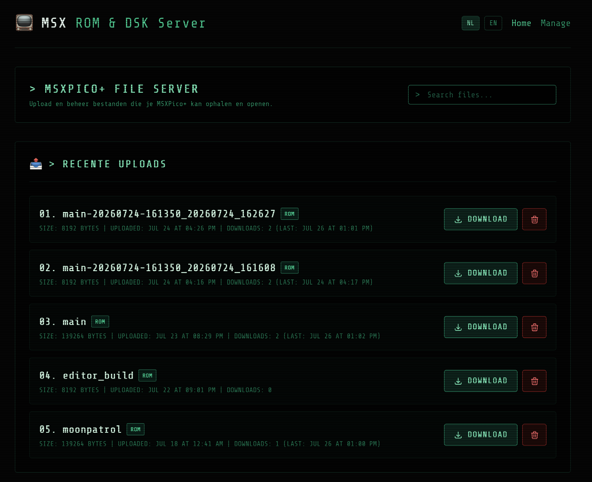

# MSX Pico DEVserver

[](https://github.com/msx-hws/mpd/actions)
[](LICENSE)
[](README.nl.md)

**MSX Pico DEVserver** (`mpd`) is a lightweight local development & ROM/COM/DSK server designed to serve MSX binaries directly over Wi-Fi to your **MSX Pico** (or compatible flash cartridge), with a retro-themed cyberpunk web management interface and developer REST API.

*Read this documentation in other languages: [Nederlands (Dutch)](README.nl.md).*



---

## 💡 What is this and how does it work?

- **For your MSX Pico:** Your MSX Pico cartridge fetches games directly over the local network via Wi-Fi. You don't need to constantly swap the SD card in and out of your computer to try new games.
- **What is an API?** An API (*Application Programming Interface*) is a digital service door that allows devices and software to talk directly to this server. Both the MSX Pico hardware and external scripts use this API to list, download, and manage files.
- **What is Docker?** Docker runs the application inside an isolated, self-contained container package with all required software and Python dependencies pre-configured. You don't need complicated local installations—everything runs with a single command.

---

## ⚡ Key Features

- **Retro Cyberpunk Design:** Fully responsive web interface with dark mode, CRT scanline overlay, and a classic terminal font.
- **Automatic ROM Padding:** MSX Pico hardware requires `.rom` files to be at least `0x1000` (4096 bytes) in size. The server automatically pads smaller ROM files with null-bytes on the fly during transfer, without altering the original files stored on the server!
- **Web File Management:** Upload, rename, download, and delete games easily from your browser via the `/manage` page.
- **Interactive API Documentation (Swagger UI):** Explore and test all endpoints directly in your browser at `/docs` or `/swagger`.

---

## 🕹️ Step-by-Step: Setting up MSX Pico with `URL.TXT`

To allow your MSX Pico cartridge to connect to this server, it needs to know the server's network address. You configure this through a single text file named `URL.TXT` on the Pico's micro-SD card.

Follow these steps carefully:

### Step 1: Insert the SD card into your computer
Place the micro-SD card from your MSX Pico into your PC or memory card reader.

### Step 2: Open or create the `FH_FILES` folder
Open the SD card in your File Explorer (Windows) or Finder (Mac).
- Look at the root (top level) of the SD card.
- Ensure there is a folder named:
  ```text
  FH_FILES
  ```
  *(If it does not exist yet, create it in UPPERCASE).*

### Step 3: Create the `URL.TXT` file
1. Open the `FH_FILES` folder.
2. Create a new plain text file named **`URL.TXT`** (make sure the filename and extension are uppercase).
3. Open this file in Notepad, TextEdit, or any plain text editor.
4. Type **only** the HTTP address of your server, including `http://` and a trailing slash (`/`).

   **Example:**
   ```text
   http://192.168.1.150/
   ```
   *(Replace `192.168.1.150` with the local IP address of the computer/server running this software).*

> [!IMPORTANT]
> **Essential rules for `URL.TXT`:**
> - **Must use Port 80 (HTTP):** MSX Pico firmware strictly expects standard port **80** (`http://`). The Pico **cannot** handle custom port numbers (such as `:8080`) in the URL. If you change the server port to anything other than 80, the MSX Pico will **fail to connect**!
> - **No HTTPS:** Always use `http://` and **never** `https://` (retro MSX hardware does not support modern SSL/TLS encryption).
> - **Trailing slash:** Always end the URL with a trailing slash (`/`), e.g., `http://192.168.1.150/`.
> - **No spaces or empty lines:** Do not include spaces before/after the URL or extra line breaks.
> - **Watch out for hidden extensions:** Ensure Windows doesn't save the file as `URL.TXT.txt` (enable "File name extensions" in Windows Explorer).

### Step 4: Put the SD card back into your MSX Pico
Safely eject the SD card, insert it into your MSX Pico cartridge, and turn on your MSX computer. As long as your MSX Pico and server are connected to the same Wi-Fi network, your game list will appear on screen!

---

## 🚀 Running the Server with Docker

Docker is the quickest and easiest way to deploy the server.

### Prerequisites
- [Docker Desktop](https://www.docker.com/products/docker-desktop/) (installed and running).

### Quickstart in 3 steps:
1. **Clone this repository:**
   ```bash
   git clone https://github.com/msx-hws/mpd.git
   cd mpd
   ```
2. **Copy the environment configuration:**
   ```bash
   cp .env.example .env
   ```
   *(By default, `HOST_PORT=80` is configured. **Leave this on port 80**, as the MSX Pico requires port 80 and does not support custom ports).*

3. **Start the container:**
   ```bash
   docker compose up -d
   ```
   *(The Tailwind CSS is compiled during the image build; no extra step needed. After changing templates or CSS, run `docker compose up -d --build`.)*

All done! Open your browser:
- Web Interface: `http://localhost/` (or your server's local IP)
- File Manager: `http://localhost/manage`
- **Swagger API Docs:** `http://localhost/docs` (or `http://localhost/swagger`)

---

## 📖 API & Swagger Documentation

The server provides a full REST API for automation and file management:
- **`GET /api/files`** — Retrieve a structured JSON list of all files and folders.
- **`POST /api/upload`** — Upload a new file (multipart form-data).
- **`GET /api/download/<path>`** — Download a specific file.
- **`DELETE /api/delete`** — Delete a file or directory.
- **`GET /index2.php`** — Legacy MSX hardware directory listing and download endpoint.

👉 **Interactive Testing:** Visit [`/docs`](http://localhost:5001/docs) or [`/swagger`](http://localhost:5001/swagger) in your browser to use the built-in **Swagger UI**. You can send live requests and inspect responses directly. The OpenAPI 3.0 specification is available at [`docs/openapi.yaml`](docs/openapi.yaml).

---

## 🔧 Troubleshooting

Having trouble connecting, encountering a Docker issue, or seeing a black screen on your MSX?
Check out our comprehensive troubleshooting guide:

👉 **[docs/TROUBLESHOOTING.md](docs/TROUBLESHOOTING.md)** *(Dutch version: [docs/TROUBLESHOOTING.nl.md](docs/TROUBLESHOOTING.nl.md))*

Topics covered:
- MSX Pico fails to connect or time-out issues.
- Port 80 conflicts (`address already in use`) and firewall rules.
- File upload permissions and naming conventions.
- ROM padding and mapper compatibility.

---

## 📄 License

This project is licensed under the MIT License - see the [LICENSE](LICENSE) file for details.
